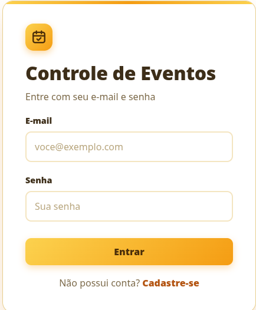
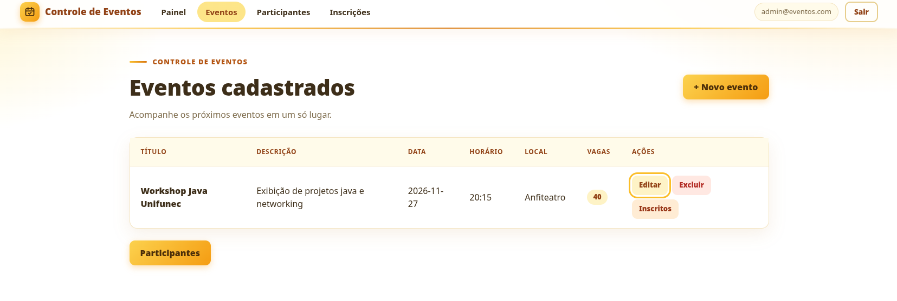
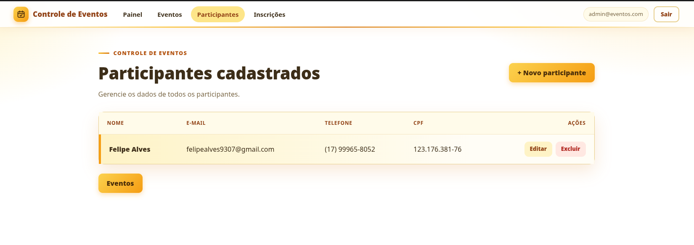
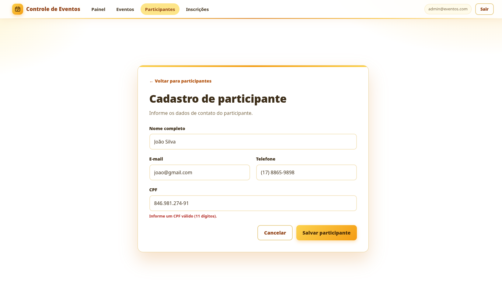

# Controle de Eventos

Projeto CRUD de **controle de eventos** em Java com Spring Boot. Permite cadastrar eventos e participantes, controlar inscrições e vagas, com acesso separado para administrador e participante.

## Funcionalidades

- Cadastro, edição e exclusão de **eventos** e **participantes**
- **Inscrições** com controle de vagas, evento aberto e bloqueio de inscrição duplicada
- Área do participante: catálogo de eventos, "Meus eventos" e cancelamento da própria inscrição
- Login com perfis **ADMIN** e **PARTICIPANTE** (Spring Security, senhas com BCrypt)
- Validação de **CPF** (dígitos verificadores) e telefone, com máscara automática nos campos
- Bloqueio de duplicidade de CPF e e-mail
- Popup de confirmação ao excluir e aviso quando o item não pode ser excluído (evento com inscritos, participante inscrito ou com conta)

## Demonstração

### Login


### Eventos cadastrados


### Participantes cadastrados


### Cadastro de participante (validação de CPF)


## Tecnologias

- Java 21
- Spring Boot 3.5.13 (Web, Thymeleaf, Data JPA, Validation, Security)
- PostgreSQL
- Maven

## Como executar

1. Instale o **Java 21** e o **PostgreSQL**.
2. Crie o banco (as tabelas são criadas automaticamente na primeira execução):
   ```sql
   CREATE DATABASE controle_eventos;
   ```
3. Defina a senha do banco na variável de ambiente `DB_PASSWORD` e rode o projeto:
   ```bash
   export DB_PASSWORD='sua_senha'
   mvn spring-boot:run
   ```
   No fish (CachyOS): `set -x DB_PASSWORD 'sua_senha'`
4. Acesse **http://localhost:8080**

## Banco de dados e acesso

| Item | Valor padrão | Variável para alterar |
|---|---|---|
| Banco | `controle_eventos` | `DB_URL` |
| Usuário do banco | `felipe` | `DB_USERNAME` |
| Senha do banco | definida por você | `DB_PASSWORD` |
| Administrador | `admin@eventos.com` | `APP_ADMIN_EMAIL` |
| Senha do administrador | `Funec24#7` | `APP_ADMIN_PASSWORD` |

O administrador é criado automaticamente na primeira execução. Novos participantes se cadastram em `/cadastro`.

> Os dados acima são apenas para demonstração. Em uso real, defina as variáveis de ambiente e não versione senhas.

## Testes

```bash
mvn test
```

## Autor

Felipe Alves
